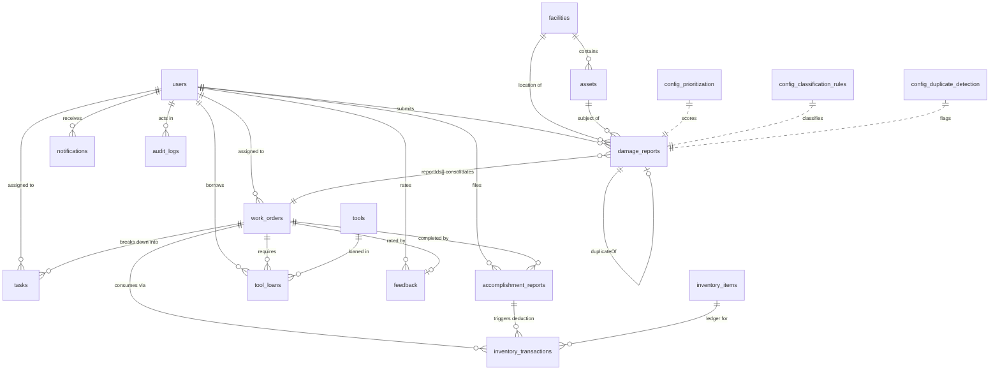

# GSUhub Data Dictionary

Objective **1.B** — the core database structure. Every collection, every
field, its type, whether it is required, and where it comes from.

## How to read the Source column

| Marker | Meaning |
|---|---|
| **§x.y** | Stated in the capstone manuscript at that section. Authoritative. |
| **Fig N** | Read off a UI figure in manuscript §3.5. Strong evidence, but a mockup is not a spec. |
| **DERIVED** | **Not in any source document.** My inference, needed to make the entity work. Review these. |
| **PENDING** | Deliberately unresolved — waiting on a decision from you. |

> ### Why so many DERIVED fields
>
> `GSUhub_Development_Plan.md` §5 — the field-level data model this
> objective was written against — was never available (see
> `architecture_decisions.md` §0). The manuscript specifies some entities
> field by field (`inventory_items` is listed verbatim in §3.4) and others
> only by name. Where the manuscript was silent, I inferred a field set and
> marked it DERIVED rather than inventing a spec and presenting it as
> yours. **Every DERIVED row is a question, not a decision.**

---

## Conventions

- **Document ids** are Firestore-generated except `users`, whose id is the
  Firebase Auth uid, and `config/*`, which use fixed names.
- **Timestamps** are stored as Firestore `Timestamp` and read back as
  **UTC** `DateTime`. Dart's `DateTime` equality compares the UTC flag as
  well as the instant, and response-time reporting across a device's local
  zone would be quietly wrong otherwise.
- **Enums** are persisted as their `name` string (`inProgress`, not `1`).
  An unknown value raises a `ValidationException` naming the field rather
  than defaulting silently.
- **`createdAt` / `updatedAt`** appear on mutable entities; immutable
  records carry a single event timestamp instead.
- **Soft deletes**: `facilities`, `assets` and `users` are deactivated,
  never removed, so historical records keep resolving their denormalized
  copies.

---

## Entity relationships

Two relationships are worth stating explicitly because they are easy to
get backwards:

- **`work_orders.reportIds` is an array, not a foreign key.** Merging
  duplicates consolidates several reports into one work order (§3.4).
  Modelling it as a single `reportId` would make merging impossible
  without deleting reports.
- **`damage_reports.duplicateOf` is self-referential.** A merged report
  keeps its own document and id; it gains a pointer to the parent. Nothing
  is deleted, so the requestor who filed the duplicate can still track it.

---

## users

Firestore id = Firebase Auth uid. Model: `AppUser`
(`features/user_management/data/models/app_user.dart`).

| Field | Type | Required | Description | Source |
|---|---|---|---|---|
| `fullName` | String | ✔ | Display name; must not be blank | Fig 20 |
| `email` | String | ✔ | Institutional email | Fig 20 |
| `role` | enum `UserRole` | ✔ | `requestor` / `maintenancePersonnel` / `admin` | §1.5 |
| `accountStatus` | enum `AccountStatus` | ✔ | `active` / `inactive` / `pending`; only `active` may sign in | §1.5; `pending` **DERIVED** (3.A) |
| `department` | String | — | Owning department | **DERIVED** |
| `contactNumber` | String | — | Phone contact | **DERIVED** (Fig 17 shows a CONTACT INFO column, populated with email only) |
| `specialization` | enum `DamageCategory` | — | Personnel trade; drives assignment suggestions | Fig 17 |
| `availability` | enum `PersonnelAvailability` | — | `available` / `busy` / `onLeave` | Fig 17 |
| `activeTaskCount` | int ≥ 0 | ✔ (default 0) | **Denormalized** count of the person's open work orders (2.B; tasks do not change it — Objective 5) | Fig 17 |
| `fcmToken` | String | — | Push delivery token | **DERIVED** (implied by §1.5 push requirement) |
| `createdAt`, `updatedAt` | DateTime (UTC) | ✔ | | **DERIVED** |

`accountStatus` and `availability` are deliberately separate: an account
can be active (may sign in) while the person is on leave (must not be
assigned work).

**How 2.C reads `availability`.** The Personnel directory shows *Busy*
from `activeTaskCount > 0` — the live workload that 2.B's assignment
transactions keep — rather than from a stored `busy`, which nothing kept
in step with the work. Only `onLeave` is read from this field, and an
administrator sets it in the account's edit dialog. Changing an account
away from maintenance personnel clears `specialization` and
`availability`, since neither means anything for another role.

Account changes made from User Accounts write an `audit_logs` entry with
`entityType: users` — `created`, `updated` (with a field-by-field
`changes` map) or `statusChanged` — in the same transaction as the
change.

### Self-registration (Objective 3.A)

A faculty or staff member who signs up from the mobile app gets a
profile written by `UserRepository.createSelfRegistration`: `role:
requestor`, `accountStatus: pending`, the lower-cased email they signed
up with, no department, the personnel fields null, and `createdAt` /
`updatedAt` as server timestamps. The security rules accept exactly that
shape and nothing more (`isSelfRegistration`). No audit entry is written
then — the rules let only active accounts write one — but approving or
declining the request from User Accounts is audited as `statusChanged`
("Approved the account request of …"). A declined request becomes
`inactive`.

## facilities

Model: `Facility`. **Largely DERIVED** — the manuscript establishes that
facilities are registered and QR-tagged (§1.5, §1.7) and shows a
BUILDING / ROOM pair (Fig 21), but gives no field list.

| Field | Type | Required | Description | Source |
|---|---|---|---|---|
| `name` | String | ✔ | Display name | Fig 21 |
| `buildingName` | String | ✔ | Building | Fig 21 |
| `roomIdentifier` | String | — | Room / sub-area | Fig 21 |
| `locationDescription` | String | — | Wayfinding detail | **DERIVED** |
| `coordinates` | GeoPoint | — | Reference point | **DERIVED** |
| `qrCode` | String | ✔ | Printed QR value; unique | §1.5, §1.7 |
| `isActive` | bool | ✔ | Soft-delete flag | **DERIVED** |
| `createdAt`, `updatedAt` | DateTime (UTC) | ✔ | | **DERIVED** |

> **Uniqueness caveat:** Firestore has no unique-field constraint.
> `qrCode` uniqueness across `facilities` and `assets` must be enforced by
> application logic — the rules cannot do it. Worth a dedicated lookup
> collection in 1.C if collisions matter.

## assets

Model: `Asset`. Equipment fixed at a facility, QR-identifiable, and
something reports are filed *about*. Distinct from `tools` (portable,
borrowed). **Largely DERIVED.**

| Field | Type | Required | Description | Source |
|---|---|---|---|---|
| `name` | String | ✔ | | §1.7 |
| `qrCode` | String | ✔ | Printed QR value | §1.5, §1.7 |
| `facilityId` | String → `facilities` | ✔ | Where it is installed | **DERIVED** |
| `condition` | enum `ItemCondition` | ✔ | excellent / good / fair / poor | Fig 15 |
| `category` | String | — | Free text, not an enum — the manuscript never enumerates asset types | **DERIVED** |
| `serialNumber` | String | — | | **DERIVED** |
| `acquiredAt` | DateTime (UTC) | — | | **DERIVED** |
| `isActive` | bool | ✔ | Soft-delete flag | **DERIVED** |
| `createdAt`, `updatedAt` | DateTime (UTC) | ✔ | | **DERIVED** |

## damage_reports

Model: `DamageReport`. The primary input to the whole lifecycle (§1.7).

| Field | Type | Required | Description | Source |
|---|---|---|---|---|
| `reporterId` | String → `users` | ✔ | | §1.7 |
| `reporterName` | String | ✔ | **Denormalized** from `users.fullName` | Fig 16 |
| `title` | String | ✔ | Short summary | Fig 21 |
| `description` | String | ✔ | Must not be blank | §3.4 Reporting Policy |
| `category` | enum `DamageCategory` | — | Null until classified | §3.4 |
| `classifiedAutomatically` | bool | ✔ (default false) | `category` came from the keyword classifier — on the phone at filing, or confirmed unchanged in review — rather than an administrator's choice (4.A) | **DERIVED** |
| `requestorCategory` | enum `DamageCategory` | — | The requestor's suggested damage type (form's DAMAGE TYPE). **A suggestion only** — never sets `category` | Figma `165:137`; 3.C |
| `facilityId` | String → `facilities` | — | Required by the form (Building + Room, or a QR scan) | §1.5 |
| `facilityName` | String | — | **Denormalized** from `facilities.name` | Fig 16 |
| `locationDescription` | String | — | Building and room, from the facility | §1.5 |
| `assetId` | String → `assets` | — | Set when an asset QR was scanned | §1.5 |
| `coordinates` | GeoPoint | — | Geo-tag; **supplementary only**. The device's fix, or a point the requestor moved the pin to | §1.5, §2.2 |
| `photoUrls` | List\<String\> | ✔ (default `[]`) | Storage download URLs under `damage_reports/{id}/`; the form requires 1–5, the rules allow up to 10 | §1.5 |
| `requestorPriority` | enum `PriorityLevel` | ✔ | Requestor's own urgency pick | §1.2 |
| `severityRating` | int 1–4 | — | Rated by the administrator in review | Table 3.4; who rates: Chris, 4.B — see below |
| `safetyRiskRating` | int 1–4 | — | Rated by the administrator in review | Table 3.4; Chris, 4.B |
| `frequencyRating` | int 1–4 | — | Rated by the administrator; pre-filled from the count of similar reports | Table 3.4; Chris, 4.B |
| `locationImportanceRating` | int 1–4 | — | Rated by the administrator in review | Table 3.4; Chris, 4.B |
| `priorityScore` | double 1.00–4.00 | — | Weighted score of the four ratings, to two decimals | §3.4 |
| `recommendedPriority` | enum `PriorityLevel` | — | Score mapped via Table 3.5 | §3.4 |
| `officialPriority` | enum `PriorityLevel` | — | **The only authoritative priority.** Set in review; required before a work order is raised (4.C) | §1.2, §1.5 |
| `status` | enum `ReportStatus` | ✔ | | §1.7 |
| `duplicateOf` | String → `damage_reports` | — | Parent after a merge | §3.4 |
| `dismissedDuplicateIds` | List\<String\> → `damage_reports` | ✔ (default `[]`) | Reports an administrator ruled are **not** duplicates of this one ("Keep separate"); written on both reports, so the pair is not flagged again | §3.4 "retain as separate"; field **DERIVED** (4.C) |
| `workOrderId` | String → `work_orders` | — | | §1.7 |
| `reviewedBy` | String → `users` | — | | §1.2 |
| `reviewedAt` | DateTime (UTC) | — | | **DERIVED** |
| `rejectionReason` | String | — | Required when `status == rejected`; null otherwise | **DERIVED** |
| `submittedAt`, `updatedAt` | DateTime (UTC) | ✔ | | §1.5 |

### Who assigns the four criterion ratings — decided (Objective 4.B)

The manuscript defines the 1–4 scale (Table 3.4) and the formula that
consumes it (§3.4), but never says who supplies the ratings, or when.
**Chris decided on 2026-10-12: the administrator rates all four while
reviewing the report**, on the report page, and the score and
recommended level update as they rate. Frequency is pre-filled from how
many reports of the same damage type were filed at the same facility in
the last 30 days, this one included (2, 3 and 5 reports suggest
Moderate, High and Very High — **DERIVED**, held in
`config/prioritization`); the administrator can change it. The count is
of every report filed, merged duplicates and rejected reports included:
each is the issue reported again.

The four ratings, `priorityScore`, `recommendedPriority` and
`officialPriority` are saved together, with `reviewedBy`/`reviewedAt`
and an audit entry, and may be revised until a work order is raised.
They stay null on a report not yet reviewed, and
`DamageReport.effectivePriority` falls back official → recommended →
requestor for display meanwhile. Reports reviewed before 4.B may carry
an official priority with no ratings.

### What a requestor may write (Objective 3.C)

The mobile form files a report through `DamageReportRepository.submit`,
which writes every field above — the administrator's ones null — plus
`submittedAt`/`updatedAt` as server timestamps, and an `audit_logs`
`created` entry in the same transaction. The security rules
(`isRequestorSubmission`) require a non-blank title (≤ 200) and
description (≤ 5000), a known `requestorPriority` and `requestorCategory`,
at most ten photo URLs and a real geo-point, and refuse any pre-set
review field (`officialPriority`, `duplicateOf`, `workOrderId`,
`reviewedBy`, `reviewedAt`, `rejectionReason`).

Since Objective 4.A the phone runs the keyword classifier as the report
is filed (there are no Cloud Functions on the Spark plan), so a new
report may carry a `category` — but only a known one, and only with
`classifiedAutomatically: true`; a category marked as an
administrator's choice is refused, as is `classifiedAutomatically: true`
without a category. The ratings, `priorityScore`, `recommendedPriority`
and a non-empty `dismissedDuplicateIds` are refused: they are the
administrator's.

A requestor reads their own reports with `reporterId == uid`, newest
first by `submittedAt`, at most 100 at a time — the rules refuse a
requestor's list query without a limit at or below 100 (Objective 3.A;
the reporter-history composite index serves it). Since 3.B the query is
a live listener.

### status_history (subcollection, Objective 3.B)

`damage_reports/{reportId}/status_history/{entryId}` — one entry per
status move, the requestor's progress timeline. Model: `StatusChange`.
**DERIVED** — §1.5 asks for "real-time status monitoring" without saying
how progress is stored.

| Field | Type | Required | Description |
|---|---|---|---|
| `status` | enum `ReportStatus` | ✔ | The status moved to |
| `changedAt` | DateTime (UTC) | ✔ | Server time of the move |
| `changedBy` | String → `users` | ✔ | Whoever made the move; the rules require the writer |
| `note` | String | — | A rejection's reason |
| `personnelName` | String | — | On `assigned`: who will do the work. **Denormalized** — a requestor cannot read `users` |
| `personnelSpecialization` | enum `DamageCategory` | — | On `assigned`: their trade |

Written in the same transaction as the move by every repository method
that moves a report: `submit`, `transitionStatus`, `mergeDuplicates`,
`WorkOrderRepository.assignFromReport` and `setStatus`. Append-only.
Read oldest first, at most 50. Reports filed before 3.B have none; the
timeline then shows their filing and current status from `submittedAt`
and `updatedAt`.

## work_orders

Model: `WorkOrder`.

| Field | Type | Required | Description | Source |
|---|---|---|---|---|
| `reportIds` | List\<String\> | ✔ (non-empty) | **Array** — merged duplicates share one work order | §3.4 |
| `title`, `description` | String | ✔ | | §1.7 |
| `category` | enum `DamageCategory` | ✔ | | §3.4 |
| `priority` | enum `PriorityLevel` | ✔ | Copied from the report's official priority | §1.2 |
| `status` | enum `WorkOrderStatus` | ✔ | Kanban column | Fig 19 |
| `assignedPersonnelIds` | List\<String\> | ✔ (default `[]`) | Crew | Fig 18 |
| `facilityId` | String | — | | **DERIVED** |
| `facilityName` | String | — | **Denormalized** | Fig 19 |
| `adminNotes` | String | — | Instruction shown to personnel | Fig 23 |
| `scheduledFor` | DateTime (UTC) | — | | **DERIVED** |
| `startedAt`, `completedAt` | DateTime (UTC) | — | | **DERIVED** |
| `createdBy` | String → `users` | ✔ | The Administrator | **DERIVED** |
| `createdAt`, `updatedAt` | DateTime (UTC) | ✔ | | **DERIVED** |

**Who moves it (Objective 5.B).** The assigned technician starts it
(`pending → inProgress`, setting `startedAt`) and submits it with the
accomplishment report (`inProgress → forReview`). The administrator signs
it off (`forReview → completed`, setting `completedAt`) or sends it back
(`forReview → inProgress`, the note in `adminNotes`). Every move runs
through `WorkOrderMove`, which moves the linked reports, writes their
timeline entries and the requestor's notice, and on completion releases
`activeTaskCount`, in one transaction.

### materials_used (subcollection, Objective 5.C)

`work_orders/{id}/materials_used/{inventoryItemId}` — what the technician
has recorded as used while the work is open. Model: `RecordedMaterial`.
One document per item; recording it again replaces the quantity.

| Field | Type | Required | Description | Source |
|---|---|---|---|---|
| `itemName` | String | ✔ | **Denormalized** | Group 43 |
| `quantityUsed` | double > 0 | ✔ | At most the stock when recorded | Group 43 |
| `unitOfMeasurement` | String | ✔ | **Denormalized** | Group 43 |
| `recordedBy` | String → `users` | ✔ | The technician | **DERIVED** |
| `recordedAt` | DateTime (UTC) | ✔ | Server time | **DERIVED** |

Nothing comes off stock here. Filing the accomplishment report copies the
list into `materialsUsed`, deducts it and deletes these documents, in the
same transaction. The rules allow writes only by an assigned technician
while the work order is pending or in progress.

### materials_allocated (subcollection, Objective 6.B)

`work_orders/{id}/materials_allocated/{inventoryItemId}` — what GSU has
set aside for the job (Group 43's "Pre-assigned Materials"). Model:
`AllocatedMaterial`. One document per item.

| Field | Type | Required | Description | Source |
|---|---|---|---|---|
| `itemName` | String | ✔ | **Denormalized** | Group 43 |
| `quantity` | double > 0 | ✔ | At most the stock when set | Group 43 |
| `unitOfMeasurement` | String | ✔ | **Denormalized** | Group 43 |
| `allocatedBy` | String → `users` | ✔ | The administrator | **DERIVED** |
| `allocatedAt` | DateTime (UTC) | ✔ | Server time | **DERIVED** |

Set by an administrator on the console's work-order page, or added to
by approving a request; read by the technicians assigned. **Moves no
stock** (Chris, 2026-10-13): §1.5 deducts "after the corresponding
accomplishment report is submitted", so only what the technician records
as used comes off. Refused once the work order is no longer open.

## tasks

Model: `MaintenanceTask` (named to avoid colliding with `dart:async`
vocabulary). **Largely DERIVED** from Fig 24's checklist.

| Field | Type | Required | Description | Source |
|---|---|---|---|---|
| `workOrderId` | String → `work_orders` | ✔ | | §1.2 |
| `title` | String | ✔ | | Fig 24 |
| `description` | String | — | | Fig 24 |
| `assignedTo` | String → `users` | ✔ | Exactly one owner | Fig 24 |
| `status` | enum `TaskStatus` | ✔ | pending / inProgress / completed | Fig 24 |
| `dueDate` | DateTime (UTC) | — | Drives "Today's To-Do" | Fig 24 |
| `proofPhotoUrls` | List\<String\> | ✔ (default `[]`) | "Upload Proof" | Fig 24 |
| `completedAt` | DateTime (UTC) | — | | **DERIVED** |
| `createdAt`, `updatedAt` | DateTime (UTC) | ✔ | | **DERIVED** |

**Who writes them (Objective 5, decided by Chris).** The administrator:
assigning a report creates the first task (the report's title, its
location as the description, due on `scheduledFor` or at once), and the
console's work-order page adds more (title up to 120 characters,
description up to 500) or deletes one not yet done. Each new task writes
a `taskAssigned` notice to the technician. The technician changes only
`status`, `completedAt` and `proofPhotoUrls`. The first task touched on a
pending work order starts it.

**The day's tasks (DERIVED).** *Today*: the open tasks of open work
orders due today, overdue or undated, then those completed today.
*Coming up*: open tasks due after today. *Overdue*: due before today and
not completed.

## accomplishment_reports

Model: `AccomplishmentReport`. Submitting one triggers automatic inventory
deduction (§3.4).

| Field | Type | Required | Description | Source |
|---|---|---|---|---|
| `workOrderId` | String → `work_orders` | ✔ | | §1.5 |
| `submittedBy` | String → `users` | ✔ | | §1.5 |
| `completionNotes` | String | ✔ | Must not be blank | Fig 23 |
| `photoUrls` | List\<String\> | ✔ (default `[]`) | Completed-work photos | §1.5 |
| `materialsUsed` | List\<`MaterialUsage`\> | ✔ (default `[]`) | Embedded; drives deduction | §3.4 |
| `inventoryDeducted` | bool | ✔ (default false) | Idempotency guard | **DERIVED** |
| `reviewedBy`, `reviewedAt` | String / DateTime | — | | **DERIVED** |
| `submittedAt` | DateTime (UTC) | ✔ | | §1.5 |

**`MaterialUsage`** (embedded, not a collection): `inventoryItemId`,
`itemName` (denormalized), `quantityUsed` (> 0, non-integer for litres /
metres), `unitOfMeasurement` (denormalized).

`inventoryDeducted` exists because the manuscript describes the automatic
deduction but not its failure modes. Without a guard, a retried submission
deducts the same stock twice.

**How one is filed (Objective 5.B).** Notes up to 2000 characters and
1–5 photos. The id is reserved before the photos upload, under
`accomplishment_reports/{id}/`. One transaction reads first (an existing
report with that id means a retry, and nothing more is written), then
files the report with the recorded `materials_used`, writes a
`consumption` ledger entry per material (with `workOrderId` and
`accomplishmentReportId`) and its new balance, deletes the recorded
list, and moves the work order to for review. `inventoryDeducted` is
true exactly when materials were used; the rules check that, and that
the work order moves to for review in the same write. Refused unless the
work is in progress and the person filing is assigned to it.

**Review.** The administrator sets `reviewedBy` and `reviewedAt` once,
approving (the work order completes) or sending it back (it returns to
in progress, the note in `adminNotes`). A send-back asks for a new
report; a filed one is never edited.

## inventory_items

Model: `InventoryItem`. **The one entity the manuscript specifies field by
field** — §3.4 lists the first seven verbatim.

| Field | Type | Required | Description | Source |
|---|---|---|---|---|
| `name` | String | ✔ | | §3.4 |
| `category` | String | ✔ | Free text — stock categories ≠ damage categories | §3.4 |
| `quantityAvailable` | double ≥ 0 | ✔ | **Never written without a matching transaction** | §3.4 |
| `unitOfMeasurement` | String | ✔ | | §3.4 |
| `storageLocation` | String | ✔ | | §3.4 |
| `qrCode` | String | ✔ | QR / barcode | §3.4 |
| `condition` | enum `ItemCondition` | — | §3.4 says "status and condition" | §3.4 |
| `minimumThreshold` | double ≥ 0 | ✔ | Low-stock trigger | §1.5 |
| `specification` | String | — | Size or pack: "Bulk", "10ft", "5 Gal" | Fig 15 (**DERIVED** field) |
| `unitCost` | double ≥ 0 | — | Pesos per unit; Total Stock Value sums quantity × this | Fig 15, Chris 2026-10-13 (**DERIVED** field) |
| `photoUrl` | String | — | The card's photo, in Storage under `inventory_items/{id}/` | Fig 15 (**DERIVED** field) |
| `createdAt`, `updatedAt` | DateTime (UTC) | ✔ | | **DERIVED** |

**How stock changes (Objective 6.A).** Only through the ledger, in the
same transaction as the balance: a new material's opening stock and a
delivery (Figure 15's cart and ORDER) are `replenishment` entries, a
physical count that differs is an `adjustment` with its reason, and an
accomplishment report's materials are `consumption` entries (5.B).
Editing a material never touches its stock. **Low stock** is
`quantityAvailable <= minimumThreshold`, read live by the console
(sidebar count, card, badges); no notification document is written
(docs/architecture_decisions.md §20).

**One code, one thing.** A `qrCode` is unique across materials, tools,
rooms and equipment together, because one scanner reads them all; the
console checks before saving. New codes default to `INV-<NAME>`,
`TOOL-<tool ID>`, `FAC-<ID>` and `AST-<ID>`.

## inventory_transactions — append-only

Model: `InventoryTransaction`.

| Field | Type | Required | Description | Source |
|---|---|---|---|---|
| `inventoryItemId` | String → `inventory_items` | ✔ | | §3.4 |
| `itemName` | String | ✔ | **Denormalized** — a ledger must stay readable forever | **DERIVED** |
| `type` | enum `InventoryTransactionType` | ✔ | issuance / consumption / returned / replenishment / adjustment | §3.4 ("issuance, usage, deduction, replenishment"); `adjustment` is **DERIVED** |
| `quantity` | double > 0 | ✔ | Always positive; direction comes from `type` | **DERIVED** |
| `quantityBefore`, `quantityAfter` | double ≥ 0 | ✔ | Balance either side | **DERIVED** |
| `workOrderId` | String | — | | §3.4 |
| `accomplishmentReportId` | String | — | Idempotency key for auto-deduction | **DERIVED** |
| `notes` | String | — | | **DERIVED** |
| `performedBy` | String → `users` | ✔ | | §3.4 |
| `performedByName` | String | — | **Denormalized**, so the history keeps a name (6.A; absent on older entries) | **DERIVED** |
| `performedAt` | DateTime (UTC) | ✔ | | §3.4 |

An `adjustment` can go either way: its `quantity` is the size of the
correction, and `quantityBefore`/`quantityAfter` give its direction.

**How append-only is enforced** (three layers, because one is not enough):

1. `InventoryTransaction` has **no `copyWith`** — deliberately, and it is
   the only model in the codebase without one.
2. `InventoryRepository` exposes no update/delete for transactions, and no
   way to write `quantityAvailable` directly. The only path is
   `recordTransaction`, which writes ledger entry and balance together.
3. `firestore.rules` allows `create` and denies `update`/`delete` for
   every role, administrators included.

> **Known gap:** security rules cannot verify that a balance write was
> accompanied by a ledger write in the same batch. A client with the
> personnel role could in principle update `quantityAvailable` alone. 1.C
> should close this with a Cloud Function or a transactional rule if the
> guarantee needs to be airtight.

## tools / tool_loans

Models: `Tool`, `ToolLoan`. Durable equipment, separate lifecycle from
consumables.

**tools** — `toolCode` (Fig 15 "TL-0824"), `name`, `status`
(`ToolStatus`), `condition` (`ItemCondition`), `qrCode`, `category`
(DERIVED), `storageLocation` (DERIVED), `currentHolderId` (Fig 15
"Current User"), `currentLoanId` (**denormalized** pointer, DERIVED),
`createdAt`/`updatedAt`.

*Invariant:* a tool with `status == borrowed` must have a
`currentHolderId` — enforced in the constructor. Personnel accountability
(§1.5) is meaningless otherwise.

**tool_loans** — `toolId`, `toolName` (**denormalized**), `borrowedBy`,
`workOrderId`, `borrowedAt`, `expectedReturnAt` (DERIVED), `returnedAt`,
`conditionOnBorrow`, `conditionOnReturn`, `notes`.

*Invariants:* `returnedAt` cannot precede `borrowedAt`; a returned loan
must record `conditionOnReturn`. Recording condition at both ends is what
makes damage attributable to a custodian (§1.5, §3.4).

**In the personnel app (Objective 5.C).** A technician borrows an
available tool by scan or from the list, against one of their work
orders or none, and returns it with its condition and an optional note.
A tool returned in `poor` condition goes to `inRepair`; otherwise it is
`available` again. Each borrow and return writes an audit entry.
Personnel list their own loans only.

**From the console (Objective 6.B, Figure 15).** Check Out writes the
loan with `borrowedBy` the technician and the administrator as the audit
entry's actor; the rules allow an administrator to create a loan only
for a maintenance-personnel account. Check In closes it as a return
does. An administrator sends an available tool to repair, brings one
back, or retires one; never a tool that is out, and a retired tool stays
retired. A tool out on loan keeps the condition it left in until it is
checked in.

## material_requests

Model: `MaterialRequest` (Objective 6.B, Group 43; §3.4 personnel
"request and monitor materials assigned to work orders").

| Field | Type | Required | Description | Source |
|---|---|---|---|---|
| `workOrderId` | String → `work_orders` | ✔ | | Group 43 |
| `requestedBy` | String → `users` | ✔ | The technician | Group 43 |
| `requestedByName` | String | ✔ | **Denormalized**, for the console's list | **DERIVED** |
| `items` | List of {`inventoryItemId`, `itemName`, `quantity`, `unitOfMeasurement`} | ✔ (1–20) | Names and units read from the inventory when filed | Group 43 |
| `status` | `pending` / `approved` / `declined` | ✔ | | Group 43 ("Pending"); outcomes **DERIVED** |
| `note` | String ≤ 300 | — | The technician's words | Group 43 |
| `adminNote` | String ≤ 300 | — | GSU's answer; required to decline | Group 43 ("Admin Note") |
| `reviewedBy`, `reviewedAt` | String / DateTime | — | Set once | **DERIVED** |
| `createdAt`, `updatedAt` | DateTime (UTC) | ✔ | Server time | **DERIVED** |

Filed by a technician assigned to the work order while it is open, under
an id reserved before sending (a retry files nothing twice). Approving
adds its items to the work order's `materials_allocated` and is refused
when the store holds less than asked; declining needs a note. Either way
the technician gets a `statusUpdate` notice about the work order. Never
deleted. Shown as `#RQ-…`.

## feedback

Model: `ServiceFeedback` (named to avoid colliding with Flutter's
`Feedback`).

| Field | Type | Required | Description | Source |
|---|---|---|---|---|
| `workOrderId`, `reportId` | String | ✔ | | §1.5 |
| `submittedBy` | String → `users` | ✔ | | §1.5 |
| `responseTimeRating` | int 1–5 | ✔ | | §1.5, §1.7 |
| `serviceQualityRating` | int 1–5 | ✔ | | §1.5, §1.7 |
| `overallSatisfactionRating` | int 1–5 | ✔ | | §1.5, §1.7 |
| `comments` | String | — | | Fig 23 |
| `submittedAt` | DateTime (UTC) | ✔ | | §1.5 |

**Three independent ratings, never blended.** Averaging them would erase
the distinction between a fast-but-sloppy repair and a slow-but-excellent
one — exactly the signal the GSU needs. Any averaging is a presentation
choice for the analytics view, not a stored field. Scale is 1–5 from the
five-star control in Fig 23.

Per §1.5, ratings "do not automatically determine personnel performance
evaluations" — which is why `firestore.rules` denies personnel read access
to this collection entirely.

### One rating per report, and it closes the report (Objective 3.C)

The document id is the report's id (**DERIVED**), so a report has at most
one rating and a second is an update, which the rules refuse.
`FeedbackRepository.rate` writes it in one transaction with the report's
move from `completed` to `closed`, a `closed` `status_history` entry and
an `audit_logs` entry. The rules hold the rating to the report's own
reporter, its work order, three integers 1–5 and server time, and allow
it only in the write that closes the report; that close is the one
change a requestor may make to their report. `comments` is trimmed and
at most 1,000 characters; blank means none. Rating is optional: a
report not rated stays `completed`.

## notifications

Model: `AppNotification`. **Document shape is DERIVED** — the manuscript
says when notifications fire (§1.5), not how they are stored.

`recipientId`, `type` (`NotificationType`), `title`, `body`,
`relatedEntityType` (a `FirestorePaths` collection name, for deep links),
`relatedEntityId`, `isRead`, `readAt`, `createdAt`.

*Invariant:* `isRead == true` requires a `readAt`.

**Who writes them (Objective 3.B).** Not a server: the project is on the
Spark plan. The client that moves a report writes its reporter's notice
in the same transaction, with `relatedEntityType: damage_reports` and
the report's id. Notified moves and their `type`: received
(`reportAcknowledged`), approved, work started or resumed, rejected and
merged (`statusUpdate`), assigned (`workOrderAssigned`), completed
(`maintenanceCompleted`). Wording: `ReportNotice.forMove` (**DERIVED**).
`createdAt` is server time, `isRead` false. A recipient marks one read
by setting `isRead` and `readAt` (server time) and nothing else.

## audit_logs — append-only

Model: `AuditLogEntry`. Backs §3.4's Auditability requirement.

`actorId`, `actorName` (**denormalized** — an audit entry must stay
legible after the account is renamed or deactivated, which is exactly when
it is most likely to be read), `action` (`AuditAction`, **DERIVED**
vocabulary), `entityType`, `entityId`, `description`, `changes`
(free-form map), `timestamp`.

No `copyWith`, no update/delete in the repository, `create`-only in the
rules. An audit trail that privileged users can rewrite is not evidence.

## config/*

Three fixed-id documents. Data rather than constants because §1.5 limits
the engine to "predefined keywords, categories, criteria, ratings, and
assigned weights" — a rule engine GSU staff cannot retune without a
rebuild would not survive a real maintenance office.

### config/classification_rules

`keywordsByCategory` (map of `DamageCategory.id` → keyword list, seeded
from Table 3.3), `caseSensitive` (**DERIVED**, default false),
`updatedAt`, `updatedBy`.

Edited on the console's **Settings** page (Objective 4.A, Chris's
choice): keywords added and removed per damage type, saved with the
administrator's uid in `updatedBy`. A keyword is 3–60 characters with a
letter or digit, and belongs to one damage type only. Matching is
**DERIVED**: a keyword's words in order, case ignored, punctuation read
as spaces, each word allowed a longer ending ("exposed wire" matches
"exposed wires"); title and description both; the damage type with the
most keywords found wins, and a tie classifies nothing.

**When a `config/*` document does not exist** — a live project nobody
has saved them in — the app uses the manuscript's values (Table 3.3's
keywords, the formula's weights, the defaults below) rather than
failing, and Settings says the keyword list is not saved yet. Any other
read failure is shown as a failure.

### config/prioritization — decided (Objective 4.B)

`activeScheme`, `integerWeights`, `decimalWeights`, `thresholds`,
`minRating`, `maxRating`, `frequencyWindowDays` (**DERIVED** default 30),
`frequencyBands` (**DERIVED** default `[2, 3, 5]`: the report counts at
which the suggested Frequency rises to 2, 3 and 4), `updatedAt`,
`updatedBy`. A document saved before 4.B, without the two frequency
fields, reads with their defaults.

**The manuscript states the weights twice and they disagree:**

| Criterion | Table 3.2 | §3.4 formula |
|---|---|---|
| Severity | 3 | 0.40 |
| Safety Risk | **4** | 0.30 |
| Frequency | 2 | 0.20 |
| Location Importance | 3 | 0.10 |

This is not a notation difference. Table 3.2 ranks **Safety Risk**
highest; the formula ranks **Severity** highest. Normalizing Table 3.2
(0.25 / 0.33 / 0.17 / 0.25) does not reconcile them. Whether a live
electrical hazard outranks a large but harmless defect is a GSU policy
question.

Both schemes are therefore stored side by side, with `activeScheme`
selecting which the scoring engine reads. Nothing is hardcoded, nothing is
silently reconciled, and changing the answer later is a one-field edit
rather than a migration.

Note also that the integer weights sum to 12, not 1.0, so scores computed
from them do not land in the 1.00–4.00 range Table 3.5's bands assume.
The scorer therefore divides by the weights' sum (a divisor of 1 with
the formula's weights), which keeps either scheme on the 1.00–4.00
scale, and rounds to two decimals before reading the bands.

**Decided 2026-10-12: Chris chose the §3.4 formula's weights (0.40 /
0.30 / 0.20 / 0.10), so `activeScheme` is `decimalWeights`. The
manuscript's Table 3.2 needs correcting to match.** Both schemes stay
stored, so the conflict remains visible.

### config/duplicate_detection

`enabled`, `matchOnFacilityIdentifier`, `matchOnLocation`,
`matchOnCategory` (the first three of §3.4's five criteria),
`descriptionSimilarityThreshold` (**DERIVED** default 0.5),
`timeWindowHours` (**DERIVED** default 72), `updatedAt`, `updatedBy`.

§3.4 lists the five comparison inputs but gives no numeric values; the
two defaults are starting points to tune against real data. Detection only
ever **flags** — §1.5 requires administrator verification before any
merge.

How the inputs combine (**DERIVED**, Objective 4.C): two open, unmerged
reports are flagged when an administrator has not already kept them
separate, they are at the same place (the same `facilityId`, or the same
stated location), they were filed within `timeWindowHours` of each
other, and they share a damage type — or their wording is at least
`descriptionSimilarityThreshold` alike and shares at least two key words.
Wording is compared as the share of the shorter report's key words the
other also uses; key words leave out common words, words under three
letters and the report's own location words, with plain endings trimmed
("leaks", "leaking" and "leaked" are one word). The threshold was 0.75
until 4.C; by this measure that almost never flagged, so the default is
0.5.

---

## Denormalization register

Every denormalized copy, and what keeps it in sync. Each one is a
deliberate read-performance trade: the alternative is an N+1 lookup per
row in a list view.

| Field | Copied from | Written by | Staleness risk |
|---|---|---|---|
| `damage_reports.reporterName` | `users.fullName` | Report creation | User renamed → stale. Acceptable: the report records who filed it *at the time*. Refresh on rename if it matters. |
| `damage_reports.facilityName` | `facilities.name` | Report creation | Facility renamed → stale. Same reasoning. |
| `work_orders.facilityName` | `facilities.name` | Work-order creation | As above. |
| `users.activeTaskCount` | count of the person's open work orders | +1 in the assignment transaction; −1 when the work order completes (`WorkOrderMove`), both atomic increments | **Highest risk.** Must be an atomic increment, never read-modify-write, or concurrent assignments will lose counts. Drift corrupts the Admin personnel view; a periodic reconciliation job is worth considering in 1.C. |
| `accomplishment_reports.materialsUsed[].itemName` / `.unitOfMeasurement` | `inventory_items` | Report submission | Intentionally frozen — a historical record should read as it did when filed. |
| `inventory_transactions.itemName` | `inventory_items.name` | Transaction creation | Intentionally frozen (ledger). |
| `tool_loans.toolName` | `tools.name` | Loan creation | Intentionally frozen (history). |
| `inventory_transactions.performedByName` | `users.fullName` | Every stock movement (6.A) | Intentionally frozen (ledger). |
| `material_requests.requestedByName`, `.items[].itemName` / `.unitOfMeasurement` | `users`, `inventory_items` | Filing (6.B) | Intentionally frozen: the request reads as it was made. |
| `work_orders/*/materials_allocated.itemName` / `.unitOfMeasurement` | `inventory_items` | Pre-assigning, approving (6.B) | Refreshed each time the quantity is set. |
| `tools.currentLoanId` | open `tool_loans` doc | Borrow / return | Must be cleared on return; a stale pointer offers a Check In action for a loan already closed. |
| `audit_logs.actorName` | `users.fullName` | Entry creation | Intentionally frozen. |

---

## Composite indexes

`firebase/firestore.indexes.json` holds **22** composite indexes, derived
from the query surface the repository interfaces actually define — not
copied from the development plan's list, which was unavailable. The count
therefore differs from the seven that list reportedly contains; treat
these as a superset to reconcile against it.

Coverage by collection: `damage_reports` (5 — reporter history, active
queue excluding duplicates, status+priority, category+status, facility
history), `work_orders` (2 — assignee board, status+priority),
`tasks` (2), `accomplishment_reports` (1), `inventory_items` (1),
`inventory_transactions` (2), `tool_loans` (2), `tools` (1),
`feedback` (1), `notifications` (2), `audit_logs` (2), `users` (1 —
personnel assignment filter).

Firestore creates single-field indexes automatically; only the composites
are listed. **Not deployed** — that is 1.C.

---

## Security rules

`firebase/firestore.rules` and `firebase/storage.rules` are written and
**not deployed**.

The permission matrix is **DERIVED from manuscript §3.4's per-role
Requirements Specification**, since the development plan's §4 matrix was
unavailable. Shape:

| | requestor | personnel | admin |
|---|---|---|---|
| `users` | own record; create own as a pending requestor (3.A) | own record | all |
| `facilities`, `assets` | read | read | full |
| `damage_reports` | create + read own; close own completed report by rating it (3.C) | read and advance status on reports of **their own** work (5.B) | full |
| `work_orders` | — | read/list **assigned only**; start (pending → in progress) and submit (in progress → for review) only (5.B) | full |
| `work_orders/*/materials_used` | — | the assigned technician records and removes, while the work is open (5.C) | read, delete |
| `work_orders/*/materials_allocated` | — | read, on their own work (6.B) | full |
| `material_requests` | — | file own, for their own open work, pending and unreviewed; read/list own (6.B) | read all; approve or decline a pending one once, a note required to decline |
| `tasks` | — | read/list own; tick off and add proof (5.A) | full |
| `accomplishment_reports` | — | file own, in the write that submits the work; read/list own (5.B) | read all, review |
| `inventory_items` | read | read + balance via transaction | full |
| `inventory_transactions` | — | create only | create only |
| `tools`, `tool_loans` | read tools | borrow/return own; list own loans (5.C) | full; a loan only to a maintenance-personnel account (6.B) |
| `feedback` | rate own completed report, which closes it (3.C); read own | **no access** (§1.5) | read all |
| `notifications` | read own, mark own read; create own "received" while filing (3.B) | read own, mark own read; create for the reporter of a report of their own work | read own; create for any report's reporter (3.B) or any technician (5.A) |
| `damage_reports/*/status_history` | read own reports'; create the first `submitted` entry while filing | read + create on reports of their own work | read + create; nobody updates or deletes |
| `audit_logs` | — | create only | read + create |
| `config/*` | read | read | full |

Deactivated and pending accounts (`accountStatus != 'active'`) lose all
access regardless of role, except reading their own `users` record. Users cannot modify their own `role` or
`accountStatus` — the obvious privilege-escalation path. Storage uploads
are capped at 10 MB and restricted to `image/*` (both **DERIVED**).

**Review this matrix against the real §4 before deploying.**

---

## Open questions summary

| # | Question | Blocks | Where modelled |
|---|---|---|---|
| 1 | ~~Which prioritization weight scheme is authoritative?~~ **Decided 2026-10-12:** the §3.4 formula's 0.40/0.30/0.20/0.10; Table 3.2 to be corrected in the manuscript | Objective 4.B (done) | `config/prioritization.activeScheme` |
| 2 | ~~Who assigns the four 1–4 criterion ratings, and when?~~ **Decided 2026-10-12:** the administrator, in review, with Frequency pre-filled | Objective 4.B (done) | Four rating fields on `damage_reports` |
| 3 | Does the real §4 permission matrix match the derived one? | 1.C deployment | `firestore.rules` |
| 4 | Do the real §5 field lists match the DERIVED entities? | Objectives 2–6 | This document |
